# Architecture `v0.2`: Cross-Four-Repo Four-Engine OpenUSD Deformable & EOS Closed-Loop Specification

> **Status**: Normative `v0.2` Design Specification (Environments Provisioned & RTX 4090 Smoke-Verified; Pre-`M1` Code Sign-Off)  
> **Scope**: `ConvertAsset` + `scenario-forge` + `trajectory-forge` + `embodied-eval-os` (`EOS`)  
> **Engine Matrix**: `Isaac Sim 4.1` + `MuJoCo 4.0.1` + `Newton 1.8.0` + `Genesis`  
> **Predecessor**: [Architecture `v0.1` & Privileged Mode Contract](architecture-v0.1.md)

---

## 1. Motivation & Ecosystem Positioning (`v0.1` → `v0.2`)

### 1.1 Absorbing `RFW-S` (arXiv:2611.23056) Into a Four-Engine OpenUSD-First Pipeline

`RFW-S` (*RoboFlyWheel-Soft*, arXiv:2611.23056) contributes 83,365 simulation-verified deformable assets across 485 everyday categories and five structural families (`soft solids`, `cloth sheets`, `shells`, `garments`, `bags`) on **Genesis 1.3.3** (MPM/PBD), built around **decoupled calibration (`Drop`) and frozen independent verification (`Compression–Release`)**.

However, `RFW-S` remains a single-asset, single-engine pool with open-loop `grasp–lift–hold` validation and rotation-contaminated strain (`0/340` intact success). Meanwhile, **OpenUSD** has become the unified physics exchange layer across modern simulators: **NVIDIA Isaac Sim 4.1**, **Google DeepMind MuJoCo 4.0.1** (via `mujoco-usd==4.0.1` and `newton-usd-schemas`), and **Linux Foundation Newton 1.8.0** all consume OpenUSD natively alongside **Genesis** (`adapters/genesis/`).

| Dimension | `RFW-S` (arXiv:2611.23056) | Our `v0.2` Four-Engine Stack |
|---|---|---|
| **Ecosystem Layer** | Isolated single-object asset pool (`ConvertAsset` tier) | Full 4-layer loop: `ConvertAsset` → `scenario-forge` → `trajectory-forge` → `EOS` |
| **Scene & Task Scope** | Empty floor / parallel plates; no rooms, articulated mechanisms, or stage goals | Composed OpenUSD + Genesis multi-DOF articulated scenes with `MetricsManager` contracts |
| **Engine Coverage** | Genesis 1.3.3 MPM/PBD only (effective solver-specific controls) | **Four-Engine OpenUSD-First Matrix**: `Isaac Sim 4.1` (`PhysX 5`) + `MuJoCo 4.0.1` (`mujoco-warp` + `flex` + `mjSTATE_PLASTIC`) + `Newton 1.8.0` (`Warp` VBD/MPM + `XPBD`/Kamino) + `Genesis` |
| **Trajectory Synthesis** | Open-loop `grasp–lift–hold` (30 mm lift); no wrench/tactile channel | Closed-loop bimanual/dexterous Python controllers (`def solve(ctx):`) over 1,500+ continuous steps |
| **Integrity Criterion** | Post-hoc `‖F - I‖_F` proxy (rotation-contaminated), yielding **`0/340` intact success** | **Rotation-invariant strain** + contact force/torque + spill gates (`intact_task_success`), guarded via tactile/wrench sensors |
| **Cross-Engine Gate & Remediation** | Single-object scalar parameter tweaking; rejects 16,317 assets | **Tiered Certification (`2/4` Silver Admission, `4/4` Gold Generalization)** + **3-tier anti-overfitting remediation router** |

### 1.2 End-to-End Four-Repository, Four-Engine Architecture

```mermaid
flowchart LR
    subgraph L1["1. ConvertAsset (Multi-Engine Deformable Parity)"]
        RFWS["RFW-S Pool (MPM / PBD)"] --> CA["Multi-Engine Deformable Compiler"]
        CA --> FIT["Drop Calibration L <= 0.05 + Compression Validation L <= 0.08"]
        FIT --> CACHE["multi_engine_deformable_bundle/v0.1 + Fracture Proxy Budget"]
    end

    subgraph L2["2. scenario-forge (OpenUSD One-Source-Three-Engines + Genesis)"]
        CACHE --> SF["Portable ScenarioSpec + safety_rules + asset_lock"]
        SF --> AD_USD["OpenUSD Scene (scene/main.usda + adapters/ebench)"]
        AD_USD --> E_IS["Isaac Sim 4.1 (PhysX FEM/PBD)"]
        AD_USD --> E_MJ["MuJoCo 4.0.1 (MjSpec.from_file + MjcPhysics)"]
        AD_USD --> E_NW["Newton 1.8.0 (newton-usd-schemas + Warp)"]
        SF --> AD_GS["adapters/genesis (genesis_package.yaml + gs.Scene)"]
    end

    subgraph L3["3. trajectory-forge (Pure-Layer Inner Solver + Subprocess Workers)"]
        E_IS --> TF["PrivilegedSolverHarness (privileged_search + snapshots)"]
        E_MJ --> TF
        E_NW --> TF
        AD_GS --> TF
        TF --> SYNTH["Tactile/Wrench-Guarded Synthesis (.npz + solve.py)"]
    end

    subgraph L4["4. embodied-eval-os (EOS Tiered Gatekeeper)"]
        SYNTH --> GATE_A["Protocol A: Origin Engine 5x Cold-Start .npz Replay + 0-Friction"]
        SYNTH --> GATE_B["Protocol B: Cross-Engine 0-Edit solve(ctx) Parity (2/4 Silver, 4/4 Gold)"]
        GATE_A --> INT["Rotation-Invariant IntegrityEvaluator"]
        GATE_B --> INT
        INT --> PASS["Admitted EpisodeTrace + Dataset"]
    end

    INT -- "Tier 1: Replay Drift or Crushed Object" --> TF
    INT -- "Tier 2: CROSS_ENGINE_PARITY_DRIFT" --> CA
    INT -- "Tier 3: Confirmed Physical Deadlock + Multi-Seed Lock" --> SF
```



**Core Principle (`v0.2`)**: One portable `scenario-forge` OpenUSD package (`scene/main.usda` enriched with `UsdPhysics`, `newton-usd-schemas`, and `MjcPhysics`) natively feeds **three** engines (`Isaac Sim 4.1`, `MuJoCo 4.0.1`, `Newton 1.8.0`), paired with `adapters/genesis/` for **Genesis** (`RFW-S` native MPM/PBD).

---

## 2. Four-Engine Parity & Provisioned Runtime Isolation

### 2.1 Four-Engine Capability Matrix

| Engine | Version & Key Packages | Deformable & Contact Strengths | OpenUSD Intake Path | Worker Env ID |
|---|---|---|---|---|
| **Isaac Sim** | `4.1` (`PhysX 5` + `CuRobo`) | GPU 120 Hz PBD (`PhysxParticleClothAPI`), Tetrahedral FEM (`PhysxDeformableBodyAPI`), RTX photorealistic rendering | Native `scene/main.usda` (`adapters/ebench/`) | Host Isaac Sim 4.1 env |
| **MuJoCo** | `4.0.1` (`mujoco-usd==4.0.1`, `mujoco-warp==4.0.1`, `warp-lang==1.19.0`) | Built-in `flexcomp` deformables, stateful elasto-plasticity (`mjSTATE_PLASTIC`), anti-tunneling speculative contacts (`mjENBL_SPECULATIVE`), 4x `nativeccd` speedup | Direct `mujoco.MjSpec.from_file()` on `.usda` via `mujoco._usd` + `MjcPhysics` + `newton-usd-schemas==0.7.0` | `sim-mujoco4-py312` |
| **Newton** | `1.8.0` (`warp-lang==1.19.0`, `usd-core==26.8`, `newton-usd-schemas==0.7.0`) | NVIDIA Warp GPU kernels, VBD & Implicit MPM deformables, batched articulated `SolverXPBD` / Kamino / Featherstone / `MJWarp` | Native OpenUSD via `newton-usd-schemas` + `newton[importers]` | `sim-newton18-py312` |
| **Genesis** | `1.3.3+` (MPM / PBD) | Native `RFW-S` MPM elastoplastic fracture & PBD cloth/bag reference | Dedicated `adapters/genesis/` (`genesis_package.yaml` + `scene_graph.json`) | Host `genesis` env |

### 2.2 Mandatory Subprocess Isolation & Provisioned Three-Host Inventory

**Hard Dependency Conflict**: `mujoco==4.0.1` (`mujoco-usd==4.0.1`, `mujoco-warp==4.0.1`) requires `Python >= 3.11`, whereas `newton[sim,importers]==1.8.0` pins `mujoco==3.17.0` and `mujoco-warp==3.17.0` (`< 4.0`). Therefore, `sim-mujoco4-py312` and `sim-newton18-py312` MUST remain isolated in separate Python 3.12 Conda environments and execute strictly out-of-process behind worker adapters (zero `torch` installed inside either physics worker to keep portable bundles lightweight).

Both environments have been provisioned across three host tiers and verified live on **`NVIDIA GeForce RTX 4090 (sm_89)`** (`2026-11-19`):

| Environment | Host Tier | Exact Interpreter / Archive Path | Verified Smoke Receipt (`RTX 4090`) |
|---|---|---|---|
| **`sim-mujoco4-py312`** (`Python 3.12.16`, `mujoco 4.0.1`, `mujoco-usd 4.0.1`, `mujoco-warp 4.0.1`, `usd-core 25.11`, `warp-lang 1.19.0`) | **Windows Native** | `C:\Users\Administrator\Miniconda3\envs\sim-mujoco4-py312\python.exe` | `PASSED` (`usd_mjc_spec_geoms=1`, `cpu_deformable_flex_nflex=1`, `gpu_qpos_z_final=0.2978418`) |
| **`sim-mujoco4-py312`** | **WSL2 (`Ubuntu-22.04-isaac`)** | `/root/miniconda3/envs/sim-mujoco4-py312/bin/python` (set `MUJOCO_GL=egl` headless) | `PASSED` (bit-identical `gpu_qpos_z_final=0.2978418`) |
| **`sim-mujoco4-py312`** | **Google Drive (`Linux x86_64`)** | `J:\我的云端硬盘\UltraSync\conda_envs\sim-mujoco4-py312-linux-x86_64.tar.gz` (`439,274,418` bytes) | Relocatable `conda-pack` + `unpack_linux_envs.sh` + `SHA256SUMS.txt` |
| **`sim-newton18-py312`** (`Python 3.12.16`, `newton 1.8.0`, pinned `mujoco 3.17.0`, `mujoco-warp 3.17.0`, `usd-core 26.8`, `warp-lang 1.19.0`) | **Windows Native** | `C:\Users\Administrator\Miniconda3\envs\sim-newton18-py312\python.exe` | `PASSED` (`SolverXPBD` on `cuda:0`, `gpu_body_z_final=0.3501249`) |
| **`sim-newton18-py312`** | **WSL2 (`Ubuntu-22.04-isaac`)** | `/root/miniconda3/envs/sim-newton18-py312/bin/python` | `PASSED` (bit-identical `gpu_body_z_final=0.3501249`) |
| **`sim-newton18-py312`** | **Google Drive (`Linux x86_64`)** | `J:\我的云端硬盘\UltraSync\conda_envs\sim-newton18-py312-linux-x86_64.tar.gz` (`940,111,321` bytes) | Relocatable `conda-pack` + `unpack_linux_envs.sh` + `SHA256SUMS.txt` |

---

## 3. Contract 1 — `ConvertAsset`: Multi-Engine Deformable Parity Compiler

### 3.1 Representation Mapping Across Four Solvers

Because `RFW-S` parameters are effective controls coupled to Genesis 1.3.3 solvers, `ConvertAsset` compiles each ingested asset into a `multi_engine_deformable_bundle/v0.1`:

| `RFW-S` Structural Family | Genesis Native | Isaac Sim 4.1 (`PhysX 5`) | MuJoCo 4.0.1 (`flex` / `MjcPhysics`) | Newton 1.8.0 (`Warp`) |
|---|---|---|---|---|
| `soft_solid` (filled-volume) | Genesis MPM elastoplastic / elastic solid | `PhysxDeformableBodyAPI` tetrahedral FEM USD | 3D `flexcomp` (`dim=3`, `elasticity`, optional `mjSTATE_PLASTIC` yield) | Newton Implicit MPM / VBD volumetric deformable |
| `cloth_sheet`, `garment` | Genesis PBD cloth / flexible-cloth | `PhysxParticleClothAPI` / 120 Hz GPU PBD USD | 2D `flexcomp` (`dim=2`, `shell` / bending + stretching compliance) | Newton VBD / XPBD cloth mesh |
| `shell`, `bag` | Genesis PBD bag-shell / sealed-membrane | Thin-shell `PhysxParticleClothAPI` / `PhysxDeformableBodyAPI` | 2D closed/open `flexcomp` shell preserving opening cavity | Newton VBD / XPBD thin shell |

### 3.2 Probe-Response Parity Fitting (`Drop` → `Compression–Release`) & Fracture Proxy

1. **Reference Extraction (Genesis)**: Record `Drop` ($r_{\text{drop}}$) and `Compression–Release` ($r_{\text{comp}}$) response summaries.
2. **Calibration Fitting ($G_{\text{cal}}$ on `Drop`)**: Fit target engine compliance/stiffness/damping parameters $\phi_{\text{target}}$ against $r_{\text{drop}}$ minimizing `RFW-S` Eq. (4) normalized discrepancy $L(c, r) \le 0.05$ (`finite_fraction = 1.0`, zero floor penetration).
3. **Frozen Independent Verification ($G_{\text{independent}}$ on `Compression–Release`)**: Freeze USD/solver time steps and fitted $\phi_{\text{target}}$, then verify $L_{\text{comp}} \le 0.08$ under compression–release:
   $$V_{\text{parity}} = G_{\text{execution}} \land G_{\text{cal}} \land G_{\text{independent}}$$
4. **Fracture & Yield Proxy Bridge (`DeformableIntegrityBudget`)**: Extract Genesis MPM fracture onset thresholds in rotation-invariant form (`max_principal_strain`, `max_normal_force_n`, `max_shear_force_n`, `(a, b)` damage bands) into `manifest.json` so non-tearing continuum solvers (Isaac PhysX FEM / MuJoCo elastic `flex` / Newton VBD) trigger identical failure boundaries.
5. **Scaling Strategy**: Pre-calibrate 485 category priors offline; run lazy on-demand per-instance fitting only when selected by `scenario-forge`, caching immutable outputs by SHA in `locks/asset_lock.yaml`.

```json
{
  "schema_version": "multi_engine_deformable_bundle/v0.1",
  "asset_id": "rfws_soft_solid_tofu_0042",
  "source_provenance": {
    "dataset": "RFW-S",
    "category": "tofu",
    "structural_family": "soft_solid",
    "source_asset_sha256": "sha256:..."
  },
  "engines": {
    "genesis": { "solver": "mpm", "profile_relpath": "genesis/genesis_entity_profile.json", "dt_s": 0.001, "substeps": 10 },
    "isaac_physx": { "solver": "physx_fem", "usd_relpath": "isaac/deformable.usd", "fit_loss_drop": 0.031, "verify_loss_compression": 0.048, "parity_verified": true },
    "mujoco4": { "solver": "flexcomp_3d", "mjc_usd_overlay_relpath": "mujoco4/mjc_overlay.usda", "parity_verified": true },
    "newton18": { "solver": "vbd_or_mpm", "newton_usd_overlay_relpath": "newton18/newton_overlay.usda", "parity_verified": true }
  },
  "integrity_budget": {
    "fragility_tier": "high",
    "strain_metric": "polar_principal_stretch",
    "strain_onset_a": 0.15,
    "strain_failure_b": 0.45,
    "damage_threshold": 0.25,
    "max_normal_force_n": 3.2,
    "max_shear_force_n": 1.4
  }
}
```

---

## 4. Contract 2 — `scenario-forge`: Portable `v0.2+` OpenUSD-First Schema & Dual/Quad Exports

Per `scenario-forge/docs/design/package-v0.2.md`, the portable package remains engine-agnostic; exports live under `adapters/<target>/`.

1. **One Portable OpenUSD Scene (`scene/main.usda`) Feeding Three Engines**:
   - Enrich `scene/main.usda` with standard `UsdPhysics`, `PhysxDeformableBodyAPI`/`PhysxParticleClothAPI`, `newton-usd-schemas`, and `MjcPhysics` overlay layers so **Isaac Sim 4.1**, **MuJoCo 4.0.1** (`mujoco.MjSpec.from_file`), and **Newton 1.8.0** all materialize the exact same scene geometry, transforms, and joint trees from one source of truth.
2. **Schema Additions (`assets/asset_manifest.yaml`, `task/safety_rules.yaml`, `metrics/metrics.yaml`)**:
   - `physics_kind: rigid | articulated | deformable_rfw_s`, `structural_family`, and `multi_engine_bundle_manifest`.
   - Per-object `integrity_budget` (`max_damage_score: 0.25`, `max_normal_force_n`, `max_shear_force_n`, `max_joint_torque_nm`, `max_spill_ratio`) and primary metric `intact_task_success`.
3. **Exporter Targets**:
   - `adapters/ebench/` (OpenUSD + GenManip runtime contract, consumed directly by Isaac Sim and OpenUSD-capable workers for Newton 1.8 / MuJoCo 4.0);
   - **New `adapters/genesis/`**: `genesis_package.yaml` + `scene_graph.json` instantiating matched world poses (`instances.yaml`), articulated URDF/MJCF assets, `lift2_r5a` robot URDF, and native `RFW-S` MPM/PBD profiles in one `gs.Scene`.

---

## 5. Contract 3 — `trajectory-forge`: Pure-Layer Multi-Engine Solver & Tactile-Guarded Synthesis

### 5.1 Enforcing Pure-Layer Isolation Across All Four Engines

In `trajectory-forge/tests/test_architecture_boundaries.py`, `PURE_MODULE_ROOTS` (`core`, `intake`, `embodiment`, `sdk`, `worker`, `trajectory`, `solver`) must remain completely simulator-free:

- Expand `FORBIDDEN_IMPORT_MARKERS` in `tests/test_architecture_boundaries.py` to forbid:
  `"import genesis"`, `"from genesis"`, `"import newton"`, `"from newton"`, `"import warp"`, `"from warp"` (in addition to `pxr`, `omni`, `isaacsim`, `genmanip`, `curobo`, `mujoco`, `torch`).
- Isolate backend implementations cleanly under `src/trajectory_forge/adapters/`:
  - `adapters/isaac_genmanip/` (existing)
  - `adapters/genesis/` (`GenesisSimBackend`, `GenesisExecutor`, `SSHGenesisExecutor`)
  - `adapters/mujoco4/` (invoking `sim-mujoco4-py312` via worker subprocess RPC)
  - `adapters/newton18/` (invoking `sim-newton18-py312` via worker subprocess RPC)
- All adapters implement `SimBackendProtocol` (`src/trajectory_forge/sdk/context.py`), exposing `tactile(group)` and `wrist_wrench(chain)`.

### 5.2 Contract Extensions (`src/trajectory_forge/core/contracts.py`) & Tactile Firewall

- Add optional `DeformableContractSpec` to `ObjectContractSpec` (`structural_family`, `damage_threshold`, `max_normal_force_n`, `max_shear_force_n`, `opening_frame`).
- New `SolvabilityDiagnostics.failure_code` values:
  - `OBJECT_INTEGRITY_VIOLATED`
  - `CROSS_ENGINE_PARITY_DRIFT`
  - `UPSTREAM_SOFT_CAVITY_COLLAPSED`
  - `UPSTREAM_FRAGILE_FORCE_DEADLOCK`
- **Tactile/Wrench Firewall**: Reading ground-truth particle deformation gradient `F` or internal solver strain during `trajectory_synthesis` raises `FirewallViolationError`. Controllers handling fragile/deformable assets MUST guard grip force via `ctx.sensors.tactile(group)` and `ctx.sensors.wrist_wrench(chain)`, recording `tactile_summary` and `wrench` channels into `episode_trajectory.npz` (`continuous_from_t0=True`, `privileged_channels_recorded=False`).
- **Inner-Loop vs. Outer-Loop Split**: `trajectory-forge` runs `privileged_search` + local gate sanity + `.npz` synthesis; authoritative certification moves to `embodied-eval-os` (`EOS`).

---

## 6. Contract 4 — `embodied-eval-os` (`EOS`): Split-Replay, Tiered Cross-Engine Matrix & Rotation-Invariant `IntegrityEvaluator`

### 6.1 Split-Replay Verification & Tiered Cross-Engine Certification (`2/4` Silver, `4/4` Gold)

| Certification Tier / Protocol | Execution Artifact & Engine Scope | Pass Requirement | Claim Granted |
|---|---|---|---|
| **Protocol A: Same-Engine Cold-Start `.npz` Gate** | Raw `.npz` action array (`privileged_state_visible_to_model=False`) on origin engine | `K = 5` independent subprocess cold starts (`>= 3/5` strict pass, `5/5` recommended) + **Zero-Friction Counterfactual** (`0/5` pass) + zero pose-write audit | Proves physical reproducibility from $t=0$ via real friction |
| **Protocol B — Silver Admission (`>= 2/4` Engines)** | Frozen `solve(ctx)` Python script (**zero code edits**) run in `>= 1` heterogeneous engine (`Isaac Sim`, `Genesis`, `MuJoCo 4.0.1`, `Newton 1.8.0`) | Origin engine passes Protocol A **AND** `>= 1` counterpart engine passes closed-loop `task_success` & `intact_task_success` via `TraceComparisonReport` | **Production Dataset Admission** (high throughput without letting one solver's quirk stall the whole pipeline) |
| **Protocol B — Gold Certification (`4/4` Engines)** | Frozen `solve(ctx)` executed across **all 4 engines** (`Isaac Sim 4.1` + `Genesis` + `MuJoCo 4.0.1` + `Newton 1.8.0`) | Passes Protocol A on origin + closed-loop `intact_task_success` across all 4 engines | **Gold Cross-Engine Generalization Badge** (benchmark showcase & sim-to-sim gold standard) |

*(Upgrading `embodied_eval_os/backends/mujoco_provider.py` and `newton_provider.py` to dispatch against `sim-mujoco4-py312` and `sim-newton18-py312` preserves clean anti-corruption boundaries via `SubprocessExecutionProvenance`.)*

### 6.2 Rotation-Invariant Full-Modal `IntegrityEvaluator`

Implement `IntegrityEvaluator(Evaluator)` under `embodied-eval-os/src/embodied_eval_os/core/evaluators/`:

1. **Eliminating `RFW-S` Eq. (5) Rotation Contamination**:
   - **Genesis MPM / Newton Implicit MPM**: Polar decomposition $F_i(t) = R_i(t) U_i(t)$ via SVD $\Rightarrow q_{\text{MPM}} = \max_{t \in \mathcal{T}_c} Q_{0.95, i}(\|U_i(t) - I_3\|_F)$.
   - **Isaac PhysX FEM/PBD, MuJoCo 4.0 `flexcomp`, Newton VBD**: Edge/tetrahedral stretch strain $q_{\text{mesh}} = \max_{t \in \mathcal{T}_c} Q_{0.95, e}(|\ell_e(t) - \ell_{e,0}| / \ell_{e,0})$ (plus `mjData.plastic` / `mjSTATE_PLASTIC` when elasto-plasticity is enabled in MuJoCo 4.0).
2. **Multi-Modal Integrity Fusion**:
   $$D_{\text{strain}} = \operatorname{clip}_{[0, 1]}\!\left(\frac{q - a}{b - a}\right), \qquad D_{\text{total}} = \max\!\left(D_{\text{strain}}, D_{\text{force}}, D_{\text{torque}}, D_{\text{spill}}\right)$$
   Emit `TaskSemanticState.hazard_events` when $D_{\text{total}} \ge 0.25$ and gate admission on `intact_task_success = bool(task_success and D_total < 0.25)`.

---

## 7. Three-Tier Closed-Loop Remediation Router & Anti-Overfitting Lock

| Observed Failure Pattern | Root Attribution | Authorized Target Repo | Forbidden Mutations |
|---|---|---|---|
| **Tier 1**: `.npz` cold-start variance (`< 3/5`), or `OBJECT_INTEGRITY_VIOLATED` while $m g / \mu_{\text{eff}} < F_{\text{fail}}$ | Controller gain, approach pose, or missing tactile guard | **`trajectory-forge` only** | `ConvertAsset` physics and `scenario-forge` scene frozen |
| **Tier 2**: Origin engine passes Protocol A, but counterpart engine fails Protocol B (`CROSS_ENGINE_PARITY_DRIFT`) | Cross-engine material/contact calibration drift | **`ConvertAsset` only** (re-fit `Drop` + `Compression–Release` on failing target engine) | `scenario-forge` layout and `solve(ctx)` frozen |
| **Tier 3**: `>= 2` engines independently confirm physical deadlock (`UPSTREAM_FRAGILE_FORCE_DEADLOCK`, `UPSTREAM_SOFT_CAVITY_COLLAPSED`, `UPSTREAM_USD_OVERDAMPED_REVOLUTE_JOINT`, `UPSTREAM_OBJECT_EXCEEDS_GRIPPER_APERTURE`) | Scene geometry, joint drive, support friction, or affordance defect | **`scenario-forge`** governed by `RemediationPolicySpec` | Must pass **Multi-Seed Perturbation Freeze Lock** ($N \ge 3$ unseen perturbed seeds in `EOS` with zero scene edits) |

---

## 8. Phase 1 Pilot Slice & Ordered Milestones (`M1`–`M4`)

- **Pilot 1 — Fragile Soft Solid (`MPM ↔ PhysX FEM ↔ MuJoCo 4.0 flex/plastic ↔ Newton 1.8 MPM/VBD`)**: Fragile tofu / soft pastry / soft pack inside a multi-stage articulated drawer/tray task; achieves Silver (`>= 2/4`) and targets Gold (`4/4`) `intact_task_success = True`, plus matched crushing counterfactual failure across engines.
- **Pilot 2 — Deformable Cloth / Bag (`Genesis PBD ↔ Isaac GPU PBD ↔ MuJoCo 4.0 flex 2D ↔ Newton 1.8 VBD`)**: Dish-cloth or open pouch inside a multi-stage tabletop task with cavity-collapse detection (`UPSTREAM_SOFT_CAVITY_COLLAPSED`).

| Milestone | Primary Repo(s) | Key Deliverables | Hard Exit Gate |
|---|---|---|---|
| **M0 (Done)** | Host Envs & `UltraSync` | `sim-mujoco4-py312` (`4.0.1`) & `sim-newton18-py312` (`1.8.0`) on Windows, WSL2 (`Ubuntu-22.04-isaac`), and Google Drive `conda-pack` | Verified on `NVIDIA GeForce RTX 4090` (`PASSED` across Windows & WSL2) |
| **M1** | `ConvertAsset` | Multi-engine parity compiler (`Isaac` / `MuJoCo 4.0` / `Newton 1.8` / `Genesis`), polar/edge strain & fracture proxy extractor | Pilot 1 & 2 pass $L_{\text{drop}} \le 0.05$, $L_{\text{comp}} \le 0.08$, and matched crushing threshold |
| **M2** | `scenario-forge` | `v0.2+` OpenUSD-first schema (`UsdPhysics` + `MjcPhysics` + `newton-usd-schemas`), SHA `asset_lock`, `adapters/genesis/` | One portable package runs natively in Isaac, MuJoCo 4.0 (`MjSpec.from_file`), Newton 1.8, and Genesis |
| **M3** | `trajectory-forge` | Subprocess worker adapters (`genesis`, `mujoco4`, `newton18`), updated `FORBIDDEN_IMPORT_MARKERS`, tactile-guarded Pilot controllers | `make ci-check` passes; zero-snapshot continuous `t=0` `1.00` solve with `tactile_summary` & `wrench` in `.npz` |
| **M4** | `embodied-eval-os` & Router | `IntegrityEvaluator`, Protocol A + Silver `2/4` / Gold `4/4` Protocol B, 3-Tier Router + Multi-Seed Freeze Lock | Pilot 1 & 2 reach `EOS` certification (Silver/Gold) + counterfactual fracture & Tier 1/2/3 verification |
