# Architecture `v0.5`: Absorbing MorphTwin (`arXiv:2611.25963`) Into the Four-Repo, Four-Engine OpenUSD Deformable Loop

> **Status**: Normative `v0.5` Design Specification (Aligned via `/grill-me` Design Review; Pre-`M1` Code Sign-Off)  
> **Scope**: `ConvertAsset` + `scenario-forge` + `trajectory-forge` + `embodied-eval-os` (`EOS`)  
> **Engine Matrix**: `Isaac Sim 6.0` (`PhysX 5`) + `MuJoCo 4.0.1` + `Newton 1.8.0` + `Genesis` + Optional Sidecar `morphtwin_spring_3dgs`  
> **Predecessors**:  
> - [Architecture `v0.1` & Privileged Mode Contract](architecture-v0.1.md)  
> - [Architecture `v0.2`: Four-Engine OpenUSD Deformable & EOS Closed-Loop](architecture-v0.2-dual-engine-deformable-eos-loop.md)  
> - [2026-11-20 `v0.3` Four-Engine Zero-Cheat Rollouts & Showcase](../records/2026-11-20-deformable-v03-m3-four-engine-zero-cheat-rollouts.md)

---

## 1. Motivation & Strategic Positioning (`v0.2–v0.4` → `v0.5`)

### 1.1 What MorphTwin (`arXiv:2611.25963`) Contributes — and Where It Stops

**MorphTwin** (*Enriching Deformable Material Responses from Videos for Morphable and Interactive Physical Twins*, USTC / HKU / Columbia / CityU HK, Nov 2026) improves video-based deformable digital twins (PhysTwin lineage) along four concrete axes:

1. **Decoupled Bulk ($\kappa$) and Shear ($\mu$) Deformation Modes**: Eliminates the $\lambda = \mu$ affine coupling of central-force spring networks via *Relaxable Response Carriers* (centroid auxiliary node for bulk cells; circumsphere symmetric pair for shear cells).
2. **Offline Energy Response Calibration & Shared Relative Edit Space**: Computes a local sensitivity Jacobian $\mathbf{A} = \partial \mathbf{q} / \partial \mathbf{u}$ where $\mathbf{q} = [\log \kappa, \log \mu]^\top$, mapping a shared relative edit $\Delta \mathbf{q}$ to graph-specific stiffness updates $\mathbf{u} = \mathbf{A}^{-1} \Delta \mathbf{q}$ for interpretable material editing and cross-object material transfer without re-running inverse optimization.
3. **Egocentric Stereo / RGB-D Video-to-Deformable Identification**: Extracts masks (`Grounded-SAM 2`), 2D→3D tracks (`CoTracker3` + depth), and shape priors (`TRELLIS`), fitting physical parameters $\boldsymbol{\theta} = (\Delta \mathbf{q}, \mathbf{b}, \eta)$ before optimizing 3D Gaussian appearance (`3DGS`).
4. **Interactive Spring Fracture & Surviving-Edge Appearance Binding**: Fails springs irreversibly under excessive strain and binds Gaussians to surviving local connections.

However, MorphTwin remains a **single-object, custom mass-spring + 3DGS runtime** driven by human hand points or force-limited control springs. It lacks OpenUSD multi-engine compilation, articulated multi-object rooms, zero-cheat robot manipulation synthesis, tactile-guarded closed-loop control, and cross-engine embodied evaluation.

### 1.2 Locked Architectural Decisions (from `/grill-me` Sign-Off)

| Branch | Locked Decision | Rationale |
| --- | --- | --- |
| **1. Engine Hierarchy** | **Four general physics engines remain primary** (`Isaac Sim 6.0`, `MuJoCo 4.0.1`, `Newton 1.8.0`, `Genesis`); MorphTwin's algorithms are natively absorbed across all 4 repos, plus an **optional lightweight `morphtwin_spring_3dgs` sidecar** in `ConvertAsset`/`EOS` for fast real-video twin alignment and baseline comparison. | Preserves OpenUSD-first industrial simulator interoperability without maintaining a 5th full articulated-robot physics engine. |
| **2. Video Real-to-Sim Intake** | Owned by **`ConvertAsset`** (`convert_asset/video_deformable_intake/`) with a **two-stage decoupled contract**: heavy vision/inversion (`SAM2`/`CoTracker3`/`TRELLIS`/optimization) runs on remote GPU workers (Colab Pro+ A100/L4 or remote RTX 4090); local Windows stays pure-contract + synthetic-truth CI proxy. `scenario-forge` consumes compiled bundles via `real2sim-result`. | Strictly obeys `dev/AGENTS.md` local-lightweight operating rule and preserves single-object asset ownership in `ConvertAsset`. |
| **3. Decoupled $(\kappa, \mu)$ Calibration** | Upgrade **`multi_engine_deformable_bundle/v0.2`** (backward-compatible with `v0.1`): keep `Drop` + `Compression–Release`, add **Volumetric / Lateral-Poisson** and **Shear / Bend** probes, and calibrate a per-engine $2 \times 2$ sensitivity Jacobian $\mathbf{A}_{\text{eng}}$ so one shared $\Delta \mathbf{q} = [\Delta \log \kappa, \Delta \log \mu]^\top$ compiles cleanly to all 4 engines + optional spring sidecar. | Fixes the current `compiler.py` limitation where `poisson` is fixed at `nu0` and only 1D `y_scale` is searched. |
| **4. 3DGS Rendering & Fracture** | **OpenUSD PBR + RTX stays primary**; add pluggable **`GaussianTwinRendererAdapter`** in `EOS` (reading optional `gs_binding.npz`) to enable **same-rollout RTX vs. 3DGS dual rendering**. Split polar strain into **volumetric vs. deviatoric** components and unify fracture via real splitting (Genesis/Spring sidecar) + unified `FractureMask` (Isaac/MuJoCo4/Newton18). | Directly leverages `EOS` Principle 2 (*same physical rollout + different renderer*) and upgrades `IntegrityEvaluator` with continuum-exact fracture channels. |
| **5. Downstream Closed Loop** | Full four-repo loop + new **`EOS` Protocol C**: `scenario-forge` declares `material_morph` sweeps/transfers; `trajectory-forge` enforces a **Material-Morph Firewall** (controllers cannot read $\Delta \mathbf{q}$ and must adapt via tactile/wrench sensing); `EOS` gates unseen $\Delta \mathbf{q}$ generalization (**Protocol C1**) and Real-to-Sim video future-prediction fidelity (**Protocol C2**). | Turns material morphing from a visual demo into a falsifiable embodied generalization benchmark. |

### 1.3 End-to-End Four-Repo `v0.5` Architecture

```mermaid
flowchart LR
    subgraph IN["0. External & Real-to-Sim Inputs"]
        VID["Egocentric Stereo / RGB-D Video"]
        RFWS["RFW-S / Sculpted v0.3 / v0.4 CAD"]
    end

    subgraph L1["1. ConvertAsset (v0.2 Decoupled Parity & Morph Compiler)"]
        VID --> VINT["video_deformable_intake (Remote GPU Worker: SAM2 + CoTracker3 + TRELLIS + Carrier Fit)"]
        VINT --> SPEC["DeformableSourceSpec + Optional carrier_graph.npz & gs_binding.npz"]
        RFWS --> SPEC
        SPEC --> PROBE["4-Probe Suite: Drop + Comp-Rel + Volumetric/Poisson + Shear/Bend"]
        PROBE --> JAC["Per-Engine Sensitivity Jacobian A_eng = d[log kappa, log mu] / du_eng"]
        JAC --> BUNDLE["multi_engine_deformable_bundle/v0.2 + Fracture Thresholds"]
    end

    subgraph L2["2. scenario-forge (OpenUSD + Material Morph Suite Compiler)"]
        BUNDLE --> SF["ScenarioSpec + material_morph (delta_q / transfer_from) + real2sim-result"]
        SF --> AD_USD["OpenUSD Scene + Per-Engine Morphed Overlays (Isaac / MuJoCo4 / Newton18)"]
        SF --> AD_GS["adapters/genesis (Morphed MPM/PBD Profile)"]
        SF --> AD_MT["Optional Sidecar Ref (morphtwin_spring_3dgs)"]
    end

    subgraph L3["3. trajectory-forge (Tactile-Adaptive Zero-Cheat Solver)"]
        AD_USD --> TF["Pure-Layer solve(ctx) + Material-Morph Firewall (delta_q Hidden)"]
        AD_GS --> TF
        TF --> ADAPT["Online Tactile / Wrench Compliance Probe & Multi-Stiffness Synthesis (.npz)"]
    end

    subgraph L4["4. embodied-eval-os (EOS Protocol A + B + C & Dual Renderer)"]
        ADAPT --> PA["Protocol A: 5x Cold-Start .npz + 0-Friction Falsification"]
        ADAPT --> PB["Protocol B: 0-Edit Cross-Engine (2/4 Silver, 4/4 Gold)"]
        ADAPT --> PC1["Protocol C1: Unseen delta_q Morphing & Fracture Generalization"]
        AD_MT --> PC2["Protocol C2: Real-Video 3D Track / CD / LPIPS Fidelity"]
        PA --> INT["Volumetric/Deviatoric IntegrityEvaluator + FractureMask"]
        PB --> INT
        PC1 --> INT
        INT --> REND["Dual RendererAdapter: RTX PBR vs. GaussianTwinRendererAdapter"]
        REND --> PASS["Certified EpisodeTrace + Material-Generalization Report"]
    end

    INT -- "JACOBIAN_ILL_CONDITIONED / MORPH_DRIFT" --> L1
    INT -- "REAL2SIM_SCALE_OR_OBSTACLE_DEFECT" --> L2
    INT -- "POLICY_STIFFNESS_OVERFIT / TACTILE_GAIN_ERR" --> L3
```



---

## 2. Contract 1 — `ConvertAsset`: Video Intake, Bulk/Shear Calibration & `bundle/v0.2`

### 2.1 Video-to-Deformable Real-to-Sim Intake (`convert_asset/video_deformable_intake/`)

Add a cleanly layered intake package without importing heavy ML stacks into core/CI paths:

- **Pure-Python Contract Layer (Local Windows & CI-safe)**:
  - `VideoObservationManifest` (`deformable_video_observation/v0.1`): camera intrinsics/extrinsics, RGB/depth/stereo paths, frame timestamps, interaction intervals (hand/tool contact frames), object mask URIs, lifted 3D track tensor (`tracks_3d.npz`), and canonical rest mesh URI.
  - `MorphTwinInversionReceipt`: recovered continuum pair $(E_{\text{est}}, \nu_{\text{est}})$ (equivalently $(\kappa_{\text{est}}, \mu_{\text{est}})$), contact/friction tuple $\eta = (k_{\text{contact}}, \mu_f, e_{\text{rest}})$, holdout future-frame 3D tracking error & Chamfer distance, plus provenance SHA-256.
  - `SyntheticVideoProxyProvider`: generates deterministic synthetic multi-view/3D-track observations from known $(E, \nu)$ reference rollouts (Spring-Gaus style) so local `pytest` verifies the entire intake → carrier calibration → `bundle/v0.2` pipeline offline in `<5 s`.
- **Remote GPU Worker Layer (`convert_asset/video_deformable_intake/remote_worker.py`)**:
  - Executes on **Colab Pro+ (`A100`/`L4`)** or **remote RTX 4090** via `UltraSync` handoff (`dev/scripts/dev_remote_hub.ps1`).
  - Pluggable pipeline stages: `Grounded-SAM 2` (masks) → `CoTracker3` + Depth/Stereo lifting (3D tracks) → `TRELLIS` shape prior alignment → **Relaxable Response Carrier** graph construction (`bulk` centroid nodes + `shear` circumsphere pairs) → inverse motion fitting $\min_{\boldsymbol{\theta}} \mathcal{L}_{\text{geo}} + \mathcal{L}_{\text{track}}$ → frozen-physics 3DGS appearance fit (`gs_binding.npz`).
  - Also supports **external checkpoint import** (`import-morphtwin-export`) for consuming pre-computed PhysTwin/MorphTwin benchmark assets directly.

### 2.2 Decoupled Four-Probe Calibration & Per-Engine Sensitivity Jacobian

Upgrade `convert_asset/deformable_parity/compiler.py` from 1D `y_scale` search (with fixed `poisson = nu0`) to a **four-probe decoupled calibration protocol**:

| Probe | Role | Measured Observables | Target Physical Mode |
| --- | --- | --- | --- |
| **`Drop`** (existing) | Dynamic settling & restitution | `drop_deformation`, `settling_ratio`, `penetration_absent` | Baseline compliance + damping |
| **`Compression–Release`** (existing) | Frozen holdout hysteresis | `compression_deformation`, `recovery_ratio`, `polar_stretch_strain` | Nonlinear elastic-plastic & damping holdout |
| **`Volumetric / Lateral-Poisson`** (new) | Confined/uniaxial plate compression with lateral expansion readout | Effective bulk response $\kappa_{\text{eff}}$ & lateral transverse strain ratio $\nu_{\text{eff}} = -\varepsilon_{\perp}/\varepsilon_{\parallel}$ | Decoupled **bulk modulus $\kappa$** / Poisson's ratio $\nu$ |
| **`Shear / Bend`** (new) | Simple shear (3D solids) or cantilever 3-point bend / shear drape (2D cloth/shell, 1D rod) | Effective shear/bending response $\mu_{\text{eff}}$ | Decoupled **shear modulus $\mu$** |

For each engine $m \in \{\text{genesis}, \text{isaac\_physx}, \text{mujoco4}, \text{newton18}, \text{morphtwin\_spring}\}$:

1. Define the engine's 2D log-control vector $\mathbf{u}_m \in \mathbb{R}^2$ (e.g., $[\log E_m, \operatorname{logit}(\nu_m / 0.495)]^\top$ for continuum solvers, $[\log k_{\text{stretch}}, \log k_{\text{bend}}]^\top$ for 2D cloth/shells, or $[u_B, u_S]^\top$ carrier log-stiffness offsets for `morphtwin_spring`).
2. Record the calibrated nominal response $\mathbf{q}^0_m = [\log \kappa^0_m, \log \mu^0_m]^\top$ at nominal control $\mathbf{u}^0_m$.
3. Estimate the $2 \times 2$ local response sensitivity Jacobian via central finite differences around $\mathbf{u}^0_m$:
   $$\mathbf{A}_m = \left.\frac{\partial \mathbf{q}_m}{\partial \mathbf{u}_m}\right|_{\mathbf{u}^0_m} \in \mathbb{R}^{2 \times 2}$$
4. Enforce a **Jacobian Invertibility Gate**: $\det(\mathbf{A}_m) \neq 0$ and condition number $\operatorname{cond}(\mathbf{A}_m) \le 25.0$ (within declared safe trust region $\|\Delta \mathbf{q}\|_\infty \le \delta_{\max}$, default $\delta_{\max} = \log(4.0) \approx 1.386$).
5. **Zero-Retrain Material Morphing & Cross-Object Transfer**:
   - **Relative edit**: given shared $\Delta \mathbf{q} = [\Delta \log \kappa, \Delta \log \mu]^\top$, compute $\Delta \mathbf{u}_m = \mathbf{A}_m^{-1} \Delta \mathbf{q}$ (with optional 1-step nonlinear secant polish if $\|\Delta \mathbf{q}\|_2 > 0.7$) and emit engine-specific parameter overlays without re-running inverse optimization.
   - **Cross-object material transfer** ($A \to B$): compute target response shift $\Delta \mathbf{q}_{A \to B} = \mathbf{q}_{\text{ref}}(A) - \mathbf{q}_{\text{ref}}(B)$ (normalized by reference volume $V$ for 3D solids or area $S$ for 2D shells) and project onto object $B$'s per-engine Jacobians $\mathbf{A}_{B,m}^{-1}$.

### 2.3 Schema: `multi_engine_deformable_bundle/v0.2`

Backward-compatible superset of `multi_engine_deformable_bundle/v0.1` (`contracts.py` continues reading `v0.1` manifests with `morph_calibration = None`):

```json
{
  "schema_version": "multi_engine_deformable_bundle/v0.2",
  "asset_id": "real2sim_sponge_block_0001",
  "source_provenance": {
    "dataset": "video_real2sim_egocentric",
    "category": "sponge",
    "structural_family": "soft_solid",
    "source_asset_sha256": "sha256:...",
    "video_observation_manifest_relpath": "video_intake/observation_manifest.json",
    "inversion_receipt_relpath": "video_intake/inversion_receipt.json"
  },
  "reference_material": {
    "youngs_modulus_pa": 18500.0,
    "poissons_ratio": 0.31,
    "bulk_modulus_pa": 16228.07,
    "shear_modulus_pa": 7061.07,
    "reference_volume_m3": 0.000216
  },
  "engines": {
    "genesis": {
      "solver": "mpm",
      "profile_relpath": "genesis/genesis_entity_profile.json",
      "fit_loss_drop": 0.024,
      "verify_loss_compression": 0.041,
      "verify_loss_volumetric": 0.038,
      "verify_loss_shear": 0.044,
      "parity_verified": true,
      "morph_calibration": {
        "control_names": ["log_E", "logit_nu"],
        "q0_log_kappa_mu": [9.6945, 8.8623],
        "jacobian_A_2x2": [[1.01, 0.42], [0.99, -0.18]],
        "condition_number": 3.85,
        "trust_region_delta_q_max": 1.386
      }
    },
    "isaac_physx": { "...": "same schema" },
    "mujoco4": { "...": "same schema" },
    "newton18": { "...": "same schema" }
  },
  "optional_sidecars": {
    "morphtwin_spring_3dgs": {
      "enabled": true,
      "carrier_graph_relpath": "sidecars/morphtwin/carrier_graph.npz",
      "gs_binding_relpath": "sidecars/morphtwin/gs_binding.npz",
      "morph_calibration": {
        "control_names": ["u_bulk", "u_shear"],
        "q0_log_kappa_mu": [9.6945, 8.8623],
        "jacobian_A_2x2": [[0.84, 0.11], [0.09, 0.78]],
        "condition_number": 1.31,
        "trust_region_delta_q_max": 1.386
      }
    }
  },
  "integrity_budget": {
    "fragility_tier": "medium",
    "strain_metric": "polar_volumetric_deviatoric",
    "volumetric_onset_a": 0.12,
    "volumetric_failure_b": 0.35,
    "deviatoric_onset_a": 0.15,
    "deviatoric_failure_b": 0.45,
    "fracture_strain_threshold": 0.50,
    "damage_threshold": 0.25,
    "max_normal_force_n": 4.5,
    "max_shear_force_n": 2.0
  }
}
```

---

## 3. Contract 2 — `scenario-forge`: Real2Sim Deformable Intake & Material-Morph Suite Compiler

1. **Extend `ScenarioSpec` & `assets/asset_manifest.yaml` (`v0.2+`)**:
   - Add `physics_kind: deformable_video_twin` alongside `deformable_rfw_s` / `deformable_sculpted`.
   - Add optional `material_morph` block per deformable instance:
     ```yaml
     material_morph:
       mode: relative_delta_q        # none | relative_delta_q | transfer_from_asset
       delta_q: [-0.693, -0.693]     # [delta_log_kappa, delta_log_mu] (e.g., 0.5x softer)
       transfer_from_bundle_id: null # e.g., smt_esd_silicone_boot
       clamp_to_trust_region: true
     ```
   - `scenario-forge suite generate` gains a `material_morph_sweep` axis (e.g., `nominal`, `soften_2x`, `stiffen_2x`, `poisson_low`, `poisson_high`, `transfer_<donor>`), compiling deterministic immutable variant packages while **freezing room geometry, object poses, articulated joints, and `MetricsManager` goals** so material generalization is cleanly isolated.
2. **Real-to-Sim Grounding Bridge (`real2sim-result/v0.1` compatible)**:
   - Extend `real2sim-result` asset entries with optional `deformable_bundle_manifest` and `video_twin_provenance` fields so `agentic-scene-factory` can place a video-reconstructed deformable object onto a reconstructed tabletop/workstation with metric pose grounding (`spatial_pose_grounding`) and lock its SHA-256 in `locks/asset_lock.yaml`.
3. **One-Source OpenUSD + Multi-Engine Morphed Overlays**:
   - At compile time, `scenario-forge` invokes `ConvertAsset`'s `apply_material_morph(bundle_v02, delta_q)` to materialize matched per-engine overlay layers (`isaac/morphed_overlay.usda`, `mujoco4/mjc_morphed_overlay.usda`, `newton18/newton_morphed_overlay.usda`, `genesis/genesis_morphed_profile.json`, and optional `sidecars/morphtwin/morphed_carrier.json`) without mutating base geometry.

---

## 4. Contract 3 — `trajectory-forge`: Material-Morph Firewall & Tactile-Adaptive Synthesis

1. **Pure-Layer Boundary Expansion (`tests/test_architecture_boundaries.py`)**:
   - Add `"import gsplat"`, `"from gsplat"`, `"import sam2"`, `"from sam2"`, `"import cotracker"`, `"from cotracker"`, `"import trellis"`, `"from trellis"` to `FORBIDDEN_IMPORT_MARKERS` across all `PURE_MODULE_ROOTS`.
2. **Material-Morph Firewall (`FirewallViolationError`)**:
   - During `full_horizon_gate`, `trajectory_synthesis`, and `EOS` Protocol C1 evaluation, controllers (`def solve(ctx):`) are **strictly forbidden** from reading ground-truth `delta_q`, morphed $(E, \nu)$, carrier stiffnesses, particle deformation gradient `F`, or internal `FractureMask` buffers.
   - `episode_trajectory.npz` exports `material_morph_privileged_visible=False` and records ground-truth `material_morph_provenance` only in the outer evaluation manifest.
3. **Online Tactile / Wrench Compliance Probing (`skills/deformable_primitives_v03.py` & `v0.5`)**:
   - Upgrade zero-cheat skill controllers (`CompliantPinchPlaceController`, `FlexibleRodRouteClipController`, `HollowShellSqueezeFitController`, `ClothEdgeFoldAndPeelController`) with a **two-phase touch-and-estimate grip guard**:
     - Phase 1 (gentle micro-preload contact): measure $\Delta F_n / \Delta w_{\text{jaw}}$ from `ctx.sensors.tactile(group)` and `ctx.sensors.wrist_wrench(chain)` over a 2–4 mm safe indentation window (`F_n <= 0.35 * max_normal_force_n`).
     - Phase 2 (adaptive force ceiling): scale target jaw closure & hold force dynamically from the measured apparent compliance so one **zero-edit** `solve(ctx)` script handles soft, nominal, stiff, and Poisson-shifted variants without crushing soft targets or dropping stiff ones.
4. **Multi-Stiffness Demonstration Synthesis**:
   - Synthesize paired sensorimotor demonstration datasets across `material_morph_sweep` variants (all verified continuous from `t=0`, zero snapshots, zero cheat attachments) to train stiffness-generalizing VLA / world-model policies.

---

## 5. Contract 4 — `embodied-eval-os` (`EOS`): Dual RTX/3DGS Renderer, Volumetric/Deviatoric Fracture & Protocol C

### 5.1 Pluggable `GaussianTwinRendererAdapter` (`embodied_eval_os/renderers/gaussian_twin.py`)

Directly implements `RendererAdapter` ([base.py](file:///i:/cpfs/shared/simulation/zhuzihou/dev/embodied-eval-os/src/embodied_eval_os/renderers/base.py)):

- Consumes a `PhysicalStateProjection` (physical node/vertex positions + `FractureMask` from any of the 4 physics engines or the `morphtwin_spring` sidecar) and optional `gs_binding.npz` from `ConvertAsset`.
- Transforms local Gaussian frames via surviving neighbor connections (so broken edges/elements render clean tears rather than stretched artifacts), compositing onto the scene camera or rendering foreground-masked frames.
- Enables **Same-Rollout Dual-Renderer Evaluation**: one physical `EpisodeTrace` rendered via both **Isaac RTX PBR** and **`GaussianTwinRendererAdapter`** to quantify sim-to-real visual gap (`renderer_generalization_gap`).
- Ships with a pure-NumPy lightweight projection/splat fallback for offline CI tests and an optional CUDA `gsplat` backend on GPU hosts.

### 5.2 Volumetric / Deviatoric `IntegrityEvaluator` & Unified `FractureMask`

Upgrade [deformable_integrity.py](file:///i:/cpfs/shared/simulation/zhuzihou/dev/embodied-eval-os/src/embodied_eval_os/core/evaluators/deformable_integrity.py):

1. **Volumetric–Deviatoric Polar Decomposition**:
   - Given deformation gradient $F_i(t) = R_i(t) U_i(t)$ (from Genesis/Newton MPM or tet meshes in Isaac/MuJoCo4/Newton18), compute volume ratio $J_i = \det(U_i)$ and isochoric stretch $\bar{U}_i = J_i^{-1/3} U_i$:
     $$q_{\text{vol}} = \max_{t} Q_{0.95, i}\!\left(|J_i(t) - 1|\right), \qquad q_{\text{dev}} = \max_{t} Q_{0.95, i}\!\left(\|\bar{U}_i(t) - I_3\|_F\right)$$
   - Separately evaluate $D_{\text{vol}}$ and $D_{\text{dev}}$ against `(volumetric_onset_a, volumetric_failure_b)` and `(deviatoric_onset_a, deviatoric_failure_b)`, emitting fine-grained hazards (`volumetric_crush_damage`, `deviatoric_shear_tear_damage`) alongside force/torque/spill damage.
2. **Unified `FractureMask`**:
   - **Genesis MPM & `morphtwin_spring` sidecar**: execute real irreversible spring failure / particle splitting when strain exceeds `fracture_strain_threshold`, exporting failed edge/element indices into `EpisodeTrace`.
   - **Isaac PhysX FEM / MuJoCo4 `flexcomp` / Newton18 VBD**: maintain a monotonic `FractureMask` over elements/edges exceeding `fracture_strain_threshold`, driving both `IntegrityEvaluator` irreversible failure (`fractured_element_ratio`) and `GaussianTwinRendererAdapter` / USD visual fracture masking.

### 5.3 Protocol C Certification & Extended Failure Router

Extend [deformable_v03_router.py](file:///i:/cpfs/shared/simulation/zhuzihou/dev/embodied-eval-os/src/embodied_eval_os/core/reports/deformable_v03_router.py) (into `deformable_v05_router.py`) with **Protocol C**:

| Gate | Scope | Pass Requirement | Claim Granted |
| --- | --- | --- | --- |
| **Protocol A** (existing) | Origin engine `.npz` cold-start (`5x`) + `0`-friction falsification | `>= 3/5` (`5/5` rec.) cold-start intact pass AND `0/5` under zero friction | Physical reproducibility via real contact friction |
| **Protocol B** (existing) | Frozen `solve(ctx)` across 4 engines (`2/4` Silver, `4/4` Gold) | Origin passes A + `>= 1` (`Silver`) or `4/4` (`Gold`) heterogeneous engines pass intact | Cross-engine physical generalization |
| **Protocol C1 — Material Morphing Generalization** (new) | Frozen `solve(ctx)` / policy across unseen $\Delta \mathbf{q}$ matrix (`soften`, `stiffen`, `poisson_low`, `poisson_high`, optional cross-object transfer) on `>= 2/4` engines | Passes `intact_task_success` on all in-envelope $\Delta \mathbf{q}$ variants **AND** fails cleanly on out-of-envelope fracture counterfactual | **Calibrated Material-Generalization Badge** (proves controller/policy is not overfit to nominal stiffness) |
| **Protocol C2 — Real-Video Twin Fidelity** (new, for video-reconstructed twins) | Holdout frames of source interaction video on compiled engine(s) + optional `morphtwin_spring_3dgs` sidecar | Holdout 3D `Track` error $\le \tau_{\text{track}}$, `CD` $\le \tau_{\text{cd}}$, and (when 3DGS enabled) foreground `LPIPS` / `PSNR` within budget | **Real-to-Sim Deformable Fidelity Receipt** |

**New Deterministic Failure Attribution Codes**:

| Failure Pattern | Reason Code | Target Repo | Action |
| --- | --- | --- | --- |
| $\operatorname{cond}(\mathbf{A}_m) > 25$ or morphed engine diverges from target $(\kappa, \mu)$ probe by $> 10\%$ | `CALIBRATION_JACOBIAN_ILL_CONDITIONED` / `MATERIAL_MORPH_CALIBRATION_DRIFT` | **`ConvertAsset`** | Refine volumetric/shear probe amplitude, trust region, or solver mapping |
| Video-reconstructed deformable asset penetrates support or mismatches metric scale in room | `REAL2SIM_POSE_OR_SCALE_MISMATCH` | **`scenario-forge`** | Re-run metric scale / contact-plane grounding in `spatial_pose_grounding` |
| Nominal passes A+B, but `soften`/`stiffen`/`poisson` variant crushes or slips while physically solvable | `POLICY_STIFFNESS_OVERFIT` / `TACTILE_COMPLIANCE_GAIN_MISCALIBRATED` | **`trajectory-forge`** | Tune online tactile compliance probing / adaptive force guard (zero $\Delta\mathbf{q}$ leakage) |
| Visual `GaussianTwinRendererAdapter` LPIPS fails while 3D Track passes | `GS_BINDING_APPEARANCE_DRIFT` | **`ConvertAsset`** | Re-fit 3DGS binding / surviving-edge neighborhood weights |

---

## 6. Two End-to-End Pilot Slices & Verification Criteria

1. **Pilot 1 — Real-to-Sim Video Deformable Twin Closed Loop (`real2sim_video_sponge_pick_place`)**:
   - **Source**: 1 real RGB-D / stereo interaction sequence (PhysTwin/MorphTwin public deformable object or self-captured egocentric sponge/plush squeeze video).
   - **Flow**: Remote GPU worker (`SAM2` + `CoTracker3` + `TRELLIS` + carrier fit + 3DGS) → `ConvertAsset` compiles `bundle/v0.2` (4 engines + `morphtwin_spring_3dgs` sidecar) → `scenario-forge` mounts into tabletop manipulation task → `trajectory-forge` runs zero-cheat tactile-guarded pick-and-place → `EOS` certifies **Protocol A + Protocol B (`>= 2/4` Silver) + Protocol C2 (holdout video Track/CD/LPIPS + RTX vs. 3DGS dual rendering)**.
2. **Pilot 2 — Existing `v0.3` Multi-Engine $\Delta\mathbf{q}$ Material Morphing & Transfer Loop**:
   - **Tasks**: `coffee_croissant_tray_to_plate` (`soft_solid`) + `lab_silicone_tube_manifold_insert` (`rod_cable`, already `3/4` engines passing in `v0.3`).
   - **Flow**: Upgrade both assets to `bundle/v0.2` with full $2 \times 2$ $\mathbf{A}_m$ Jacobians → generate `scenario-forge` material-morph suite (`nominal`, `soften_2x`, `stiffen_2x`, `poisson_shift`, plus cross-object transfer `silicone_boot → croissant`) → run **one frozen zero-edit** tactile-adaptive controller in `trajectory-forge` → certify **Protocol A + B + C1** in `EOS` (including matched volumetric/deviatoric `FractureMask` counterfactual failures).

---

## 7. Ordered Milestones (`M1`–`M5`) & Compute Routing

Strict compliance with `dev/AGENTS.md` (**Local Windows stays lightweight; heavy vision/optimization/rendering routes to Google AI Ultra or remote 4090**):

| Milestone | Primary Repo(s) | Key Deliverables | Compute Tier | Hard Exit Gate |
| --- | --- | --- | --- | --- |
| **M1** | `ConvertAsset` | `multi_engine_deformable_bundle/v0.2` schema, Volumetric/Lateral-Poisson & Shear/Bend probes, $2 \times 2$ Jacobian $\mathbf{A}_m$ solver, `apply_material_morph` + cross-object transfer CLI, offline unit tests | Local Windows (unit/contracts) + 4090 / WSL2 workers (4-engine probes) | Pilot 2 assets pass 4 probes ($L_{\text{drop}} \le 0.05$, $L_{\text{comp}} \le 0.08$, $\operatorname{cond}(\mathbf{A}_m) \le 25$) and $\Delta \mathbf{q}$ round-trip error $\le 10\%$ across engines |
| **M2** | `ConvertAsset` | `video_deformable_intake/` contracts, `SyntheticVideoProxyProvider`, Relaxable Response Carrier graph builder + offline calibration (`morphtwin_spring_3dgs` sidecar), remote Colab/4090 worker script for `SAM2`/`CoTracker3`/`TRELLIS`/3DGS | Local Windows (contracts + synthetic CI) + **Colab Pro+ A100/L4** (real video intake) | Synthetic Spring-Gaus benchmark recovers $E$ & $\nu$ with decoupled carrier gain over central-force baseline; Pilot 1 real video exports valid `bundle/v0.2` + `gs_binding.npz` |
| **M3** | `scenario-forge` | `ScenarioSpec` `material_morph` + `suite generate` sweep axis, `real2sim-result` deformable bundle hook, deterministic morphed multi-engine overlay compiler | Local Windows | One portable package compiles matched morphed overlays for Isaac/MuJoCo4/Newton18/Genesis with immutable pose/layout locks; `make ci-check` green |
| **M4** | `trajectory-forge` | Material-Morph Firewall enforcement, expanded `FORBIDDEN_IMPORT_MARKERS`, online tactile/wrench compliance probing in `v0.3`/`v0.5` skills, multi-stiffness `.npz` synthesis | Local Windows (AST/unit) + 4090 / GCP Spot L4 (rollouts) | Zero-edit controller solves Pilot 1 & Pilot 2 across `nominal` + morphed $\Delta\mathbf{q}$ sweep with `snapshots_used=0`, `material_morph_privileged_visible=False` |
| **M5** | `embodied-eval-os` | Volumetric/deviatoric `IntegrityEvaluator` + unified `FractureMask`, `GaussianTwinRendererAdapter` (RTX vs. 3DGS dual render), **Protocol C1 & C2**, `deformable_v05_router.py`, offline HTML showcase | Local Windows (EOS core/CI) + 4090 / Colab (3DGS/RTX render) | Pilot 1 passes A + B(Silver) + C2; Pilot 2 passes A + B(Silver/Gold) + C1 + counterfactual fracture + Router attribution tests |

