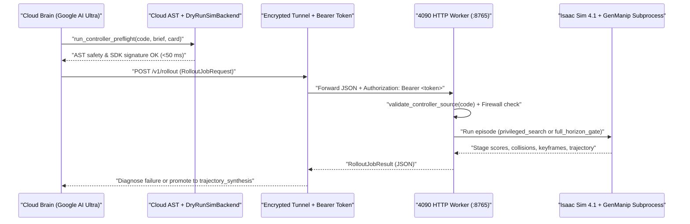

# Google AI Ultra Cloud Brain to RTX 4090 Sim Worker Workflow

## 1. Why Split Cloud Brain vs. Local RTX 4090 Sim Worker?

| Layer | Where It Runs | Hardware / Quota Reason |
|---|---|---|
| Repo development, agent orchestration, Python controller synthesis, VLM failure frame critique, pure unit tests & `<50 ms` dry-run preflight | **Google AI Ultra** workspace (Antigravity / Firebase Studio / Cloud CPU) | Uses Ultra high-priority agent quotas, long context, and zero-GPU Python stdlib execution. |
| Isaac Sim `4.1` (`2023.1.1`) + `GenManip-Sim` + PhysX + `CuRobo` + RTX keyframe rendering + heavy USD/trajectory storage | **Local RTX 4090 (46 GB VRAM, 128-core Xeon)** host | Isaac Sim Omniverse RTX strictly requires hardware **RT Cores + Vulkan** (unavailable on Colab A100; Colab L4 sessions lack persistent USD/Isaac storage and Ultra GCP credits of ~\$40–\$100/mo are better preserved than burning full-time L4 VMs). |

---

## 2. End-to-End Remote RPC Protocol (`trajectory-forge-rollout-rpc/v0.1`)



### Security & Safety Controls
1. **Bearer Token Auth**: Set `TF_WORKER_TOKEN` on the 4090 worker; requests without matching `Authorization: Bearer <token>` fail with HTTP `401` (`hmac.compare_digest`).
2. **AST Sandbox (`validate_controller_source`)**: Rejects `subprocess`, `socket`, `os`, `pathlib`, `open`, `eval`, `exec`, and requires `def solve(ctx):` before any code is compiled or forwarded.
3. **Network Transport Options** (never expose `:8765` unauthenticated on public `0.0.0.0`):
   - **Option A (Recommended for single-user dev)**: `ssh -N -R 8765:127.0.0.1:8765 <cloud-dev-host>` or reverse-tunnel `ssh -N -L 8765:127.0.0.1:8765 <4090-host>`.
   - **Option B (Tailscale / private mesh)**: Bind worker to Tailscale interface IP with `TF_WORKER_TOKEN`.
   - **Option C (Cloudflare Tunnel)**: Expose HTTPS endpoint with `TF_WORKER_TOKEN` + Cloudflare Access service token.

---

## 3. Concrete Startup & Smoke Commands

### On the Local RTX 4090 Host

1. Verify `scenario-forge` `r3` intake packages with the pure Python environment:

```bash
cd /cpfs/user/zhuzihou/dev/trajectory-forge
PYTHONPATH=src /cpfs/user/zhuzihou/conda-managed/envs/embodied-eval-os-py310/bin/python \
  -m trajectory_forge.cli intake inspect \
  --package /cpfs/user/zhuzihou/dev/scenario-forge/external_artifacts/out_of_domain_factory_r3_20261113/packages/specialty_coffee_bar_creatista_prep \
  --embodiment configs/embodiments/lift2_r5a_bimanual.yaml
```

2. Start the worker daemon (bound to loopback `127.0.0.1` for SSH/tunnel forwarding):

```bash
export TF_WORKER_TOKEN="replace-with-strong-random-token"
PYTHONPATH=src /cpfs/user/zhuzihou/conda-managed/envs/embodied-eval-os-py310/bin/python \
  -m trajectory_forge.cli worker serve --host 127.0.0.1 --port 8765
```

### On the Google AI Ultra Cloud Brain

1. Run local cloud preflight before spending GPU rollout time:

```bash
PYTHONPATH=src python -m trajectory_forge.cli controller preflight \
  --controller examples/sample_privileged_controller.py \
  --embodiment configs/embodiments/lift2_r5a_bimanual.yaml \
  --mode full_horizon_gate
```

2. Submit a job over the tunnel with `RolloutWorkerClient`:

```python
from pathlib import Path
from trajectory_forge.core.contracts import RolloutJobRequest
from trajectory_forge.worker.client import RolloutWorkerClient

client = RolloutWorkerClient(base_url="http://127.0.0.1:8765", auth_token="replace-with-strong-random-token")
print(client.health())

job = RolloutJobRequest(
    job_id="r3_coffee_search_01",
    scenario_package_ref="specialty_coffee_bar_creatista_prep",
    embodiment_id="lift2_r5a_bimanual",
    mode="privileged_search",
    seed=101,
    controller_code=Path("examples/sample_privileged_controller.py").read_text(encoding="utf-8"),
)
result = client.submit_rollout(job)
print(result.status, result.final_score, result.diagnostics)
```
